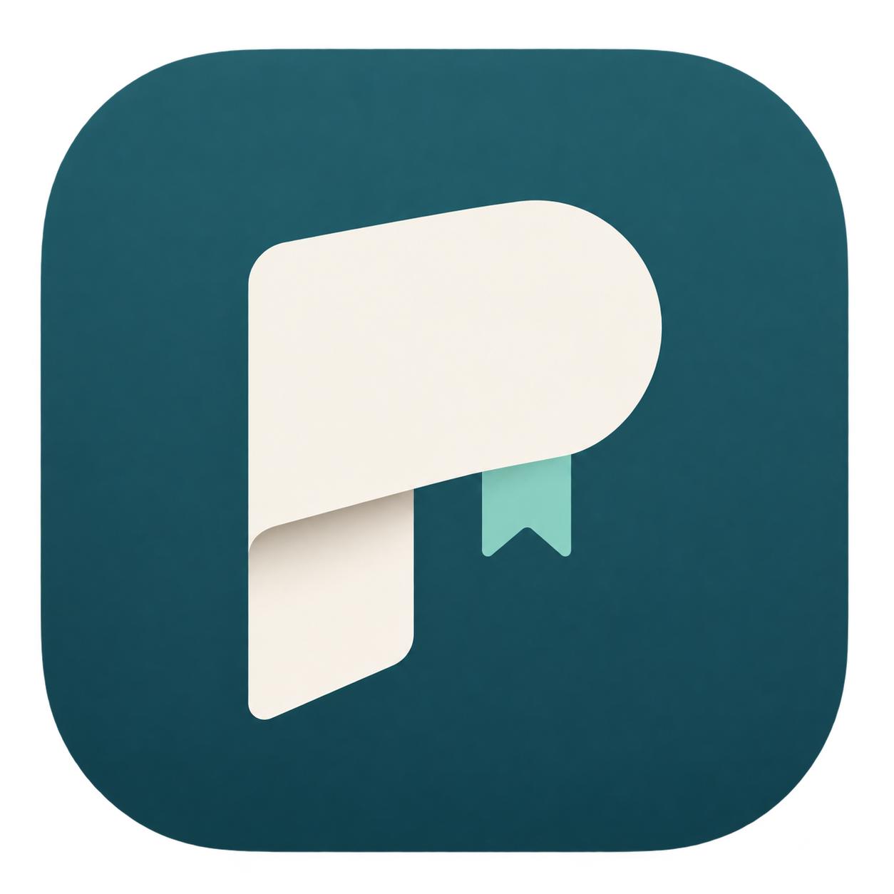

<p align="center"></p>

# PaperDesk

**在 Mac 上阅读、整理论文，并结合原文与大模型讨论。**

PaperDesk 将 PDF 阅读器、分层文献库、笔记和 AI 对话放在同一个窗口里。论文默认保存在本机；你可以指定书库存储文件夹，按需接入自己的模型服务，或启用百度网盘手动备份。Chrome 扩展负责把网页上的 PDF 收进书库。

当前源码版本：**macOS 应用 0.11.1 · Chrome 扩展 0.3.2**。项目仍处于开发预览阶段。

- 系统：**macOS 14 或更新版本**。
- 架构：支持 Apple Silicon；打包脚本也可生成含 Intel 的 Universal 版本。Intel 已完成交叉编译，尚未在 Intel 实机验证。
- 技术：SwiftUI、AppKit、PDFKit、SQLite；不需要额外安装 PDF 渲染引擎。
- 许可证：[Apache License 2.0](LICENSE)；内置第三方资源保留各自许可证。

[快速开始](#快速开始) · [使用方法](#使用方法) · [存储与备份](#存储与备份) · [Chrome 扩展](#chrome-扩展) · [隐私与数据流向](#隐私与数据流向) · [开发与验证](#开发与验证)

## 功能一览

| 功能 | 当前支持 |
| --- | --- |
| PDF 阅读 | 翻页、缩放、适合窗口、目录、正文搜索、选区和阅读位置恢复 |
| 文献管理 | 多级文件夹、移动和重命名、拖放归类、PDF 内容去重 |
| 文献搜索 | 本地标题、元数据与可提取正文搜索；按需搜索 arXiv |
| 后台导入 | arXiv 结果选择目标文件夹，查看任务数量、进度、取消和重试 |
| 阅读笔记 | 选区高亮、笔记、导出带批注 PDF 和 Markdown 笔记 |
| 模型对话 | Chat Completions 兼容接口、流式回答、连续追问、引用跳转 |
| 分析范围 | 自动识别问题，也可指定当前页、选中内容或全文相关内容 |
| 图文解读 | 真实 PDF 页面预览、放大与定位；可选向视觉模型发送页面图片 |
| 公式排版 | 离线 Markdown、LaTeX 公式和表格显示 |
| 浮窗讨论 | 选区启动浮窗，点击 PDF 收回侧栏，应用失焦时保留浮窗状态 |
| 本地存储 | 指定文件夹、迁移完整书库、打开已有书库、磁盘不可用时恢复入口 |
| 可选云备份 | 百度网盘手动保存／恢复论文、目录、笔记和阅读进度 |
| Chrome 收集 | 当前 PDF、网页 PDF 链接、内嵌 PDF、论文元数据链接 |

## 快速开始

### 从源码运行

需要 Xcode Command Line Tools（Swift 5.9 或更新版本）。Node.js 和 Python 3 仅用于相应测试脚本，运行打包后的应用不需要它们。

```bash
# 如尚未安装 Apple 开发工具
xcode-select --install

git clone https://github.com/jhxu-org/PaperDesk.git
cd PaperDesk
bash scripts/build-app.sh
open dist/PaperDesk.app
```

脚本编译当前机器架构，生成图标、组装 `.app` 和内置 Chrome 扩展，并进行本机 ad-hoc 签名。也可在 Xcode 中打开 `Package.swift`。

首次使用：

1. 按 `⌘O` 导入 PDF，或把文件拖入应用。
2. 在侧栏创建文件夹，按项目或主题整理文献。
3. 打开论文，在右侧记录笔记；需要模型时再进入「模型设置」。
4. 如需改变数据位置，打开侧栏底部的「存储设置」。无需配置百度网盘即可使用本地书库。

### 安装已导出的包

前往 [GitHub Releases](https://github.com/jhxu-org/PaperDesk/releases) 下载预览版：

- **Mac 应用**：下载 `PaperDesk-<版本>-macOS-universal.dmg`，将 `PaperDesk.app` 拖入 Applications。也提供应用 ZIP 作为替代。
- **Chrome 扩展**：下载 `PaperDesk-Chrome-<版本>.zip`，解压后按下方扩展安装步骤加载。
- **校验与指南**：同一 Release 附带 `SHA256SUMS.txt` 和安装指南。校验和用于检查文件是否与发布内容一致，不能代替开发者签名。

完整步骤见 [安装指南](Distribution/安装指南.html)。二进制包作为 Release 附件提供，不放入 Git 源码历史；上面的构建命令也可自行生成应用。

当前打包脚本只做 ad-hoc 签名，**尚未提供 Apple Developer ID 签名或公证**。macOS 可能要求在「系统设置 → 隐私与安全性」中允许打开；只对确认来源的安装包操作，不需要关闭系统安全机制。

## 使用方法

### 整理论文

- 「文件夹」旁的加号或 `⌘⇧N` 创建目录。右键目录选择「新建子文件夹」，也可在新建窗口选择上级，支持多层嵌套。
- 选中文件夹后导入 PDF，论文进入该目录。可拖动论文归类，或右键选择「移动到」。
- 父目录列表包含子目录中的论文。目录可展开、收起、重命名和移动；不能移动到自身或后代目录。
- 相同内容的 PDF 通过 SHA-256 去重，重复导入不会更改已有论文的分类。
- 删除目录需确认；其子目录一并移除，论文变为「未分类」，PDF、笔记和对话保留。

### 搜索与 arXiv 导入

打开文献搜索，先在本地书库中查找标题、元数据或正文。没有合适结果时，可切换到 arXiv 搜索；联网搜索会发送你提交的关键词。

在 arXiv 结果上点击「导入」，先选择目标文件夹，再加入后台队列。下载过程中可以继续阅读、聊天或关闭搜索窗口。窗口中显示任务数量，点击后可查看下载和入库进度、取消任务或重试失败项。文件夹在等待过程中被删除时，任务会妥善回落到未分类。搜索框的 `×` 按钮清空当前输入。

arXiv 下载受网络、限流和论文文件大小影响；文献结果不等于已导入，入库成功后才能离线阅读。当前不支持其他学术搜索平台的统一检索。

### 阅读、笔记与导出

正文搜索使用 `⌘F`。选中文字后可以高亮、记笔记或开始讨论。笔记关联原文位置，阅读进度自动保存。

应用保存导入 PDF 的副本，高亮显示由 PDFKit 加载，原始副本保持不变。使用导出操作生成带批注 PDF 或 Markdown 笔记，便于分享和在其他工具中使用。导出文件可能包含论文内容、批注和笔记，请自行选择分享范围。

双击窗口顶部可按 macOS 的窗口缩放行为调整大小。

### 接入大模型

按 `⌘,` 打开模型设置，选择预设或填写兼容服务：

1. **基础地址**：模型服务的 API 根路径；应用追加 `/chat/completions`。地址若已含此后缀，会先规范化。
2. **模型 ID**：按服务端实际提供的名称填写，也可尝试加载模型列表。
3. **API Key**：在应用中输入，不要写入源码、README 或 Issue。无需认证的本机服务可以留空。
4. 选择是否流式输出，点击连接测试，再保存。连接测试只发送简短测试消息，不附带论文。

支持 OpenAI、DeepSeek 等提供 Chat Completions 兼容接口的服务，也可使用 Ollama 的兼容接口和自建网关。支持范围由接口格式决定；并非所有供应商原生 API、模型或参数都能直接使用。模型名称、额度和费用由所用服务决定。

远程地址必须使用 HTTPS；HTTP 仅允许 `localhost`、`127.0.0.1` 或 `::1` 本机地址。模型请求只允许同源跳转，跨主机、端口或协议跳转会被阻止；遇到提示时填写服务的最终基础地址。

API Key 按规范化后的服务地址分别存入 macOS 钥匙串。遇到钥匙串授权问题时，可以授权后重试，或选择「仅本次使用」；后者只在内存中保留凭据，退出后需重新填写。

### 与原文对话

在右侧「阅读助手」中输入问题。`Enter` 或 `⌘Enter` 发送，`Shift+Enter` 换行；输入法仍在选词时，Enter 用于确认文字。

- **自动识别**：结合问题和上下文选择分析范围，不因当前停留在某页就将所有问题限制到这一页。
- **当前页**：围绕当前 PDF 页面的文本。
- **选中内容**：重点分析选区；跨页选区保留页码来源。
- **全文相关内容**：从论文中检索相关片段，并非把整本 PDF 一次完整送入模型。

回答中的有效来源标记可跳回 PDF 核对。历史对话保留各轮分析范围；新一轮会带入近期历史，不保证无限上下文。没有文本层的扫描件暂不支持 OCR，内容提取和检索可能受 PDF 排版影响。模型仍可能误解或遗漏，请结合原文判断。

选区后按 `⌘⇧J`，可在浮窗中讨论。应用失去焦点时浮窗保持当前状态；点击 PDF 阅读区会自动收回侧栏，保留当前对话。

### 图文与公式

回答支持 Markdown 表格和 LaTeX 行内／独立公式。公式脚本、样式和字体随应用内置，运行时不从 CDN 加载。

需要解释图表时，应用可在回答中插入最多三幅**原 PDF 整页预览**，支持放大和跳回原文。这些预览不是模型生成的图，也不代表已自动裁出某一图表。

「发送页面图片」是可选的视觉输入开关，按服务和模型保存，默认关闭。关闭时，模型仅看到文本和图注；本机显示预览不代表模型看过图片。开启后，相应页面会以 JPEG 随问题发送，需使用支持视觉输入的模型，并可能增加请求体积和费用。

## 存储与备份

### 指定本地文件夹

「存储设置」显示当前书库路径。默认书库为：

```text
~/Library/Application Support/PaperDesk/
├── Documents/          # PDF 副本
└── library.sqlite      # 文献、目录、笔记、进度、对话及引用
```

点击「选择存储文件夹…」选择目标父目录，再确认「迁移并使用此文件夹」。应用会在目标中创建 `PaperDesk Library`，复制完整书库。迁移使用 SQLite 备份 API，包含已提交的 WAL 数据，并校验 PDF 的 SHA-256；全部成功后才切换。

- 原位置保留副本；切换后的修改只写入新位置，两份书库不会自动同步。
- 不覆盖已有同名目标，不允许将目标放入当前书库内部；迁移可查看进度和取消。
- 导入、模型生成或云端传输进行中时，需先完成或停止该操作。
- 外置磁盘不可用时显示恢复入口，不会静默创建空书库。重新连接磁盘即可恢复访问。
- 「打开已有书库…」选择包含 `Documents` 和 `library.sqlite` 的书库根目录。这是**切换书库，不是合并**。

Chrome 接收暂存目录固定为默认应用数据目录中的 `BrowserInbox`，最终论文写入当前选定的书库。模型设置、凭据和存储位置偏好不属于书库文件，迁移书库不会迁移钥匙串。

手动备份时，建议先退出应用，再复制整个书库目录。不要在应用运行时仅复制 `library.sqlite` 而遗漏 SQLite WAL 文件。不支持多台机器同时写入同一份 SQLite 书库；选择同步盘目录不等于获得安全的实时多设备同步。

### 可选百度网盘

百度网盘在「存储设置 → 云端备份」中启用，新安装默认关闭；已有配置会保留启用状态。本地阅读与存储不依赖它，关闭开关不会删除凭据或已有云端文件。

1. 启用后点击「配置百度网盘…」。准备具有相应网盘读写权限的百度开放平台应用，在软件中填写自己的 **AppKey、SecretKey**。
2. 配置目录，例如 `/apps/你的应用目录名/PaperDesk`，其中应用目录名应与百度后台分配的一致。
3. 点击「登录百度网盘」，在百度官方网页完成设备码授权。SecretKey 与 OAuth 令牌通过钥匙串或明确选择的本次会话方式保管。
4. 点击「保存到百度网盘」，手动创建全书库快照；之后有更改需再次保存。
5. 在「读取云端版本」中选择版本并恢复。先下载并校验 PDF，再以事务合并数据；已有论文的本地分类和阅读进度保留，笔记去重，不同内容分别保留。

备份包含 **PDF 原件、多级文件夹、阅读进度、高亮和笔记**；**不包含 AI 对话或模型凭据**。它是手动保存／恢复，不是自动双向同步，也不是以云端替代本地数据库。

```text
/apps/你的应用目录名/PaperDesk/
├── objects/<SHA256>.pdf
└── snapshots/
    ├── <时间戳>_<UUID>-notes.md
    └── <时间戳>_<UUID>.json
```

相同 PDF 复用对象，索引最后上传，完整版本才会出现在恢复列表。失败或取消可能留下未被版本引用的文件，但不删除已有版本。单个 PDF 上限 500 MiB，索引上限 20 MiB。兼容旧版单层目录备份，新版层级格式需要 PaperDesk 0.6 或更新版本恢复。

云端 PDF 与笔记**没有额外端到端加密**。功能仅在配置的应用目录中保存／读取，不整理网盘其他文件。断开连接清除本机保存的凭据；撤销百度账号侧授权需在百度管理。真实授权和传输还受应用权限、账号与网络影响。

## Chrome 扩展

### 安装与使用

1. 先将 PaperDesk 放到固定位置并运行。
2. 在应用的「File → Chrome 扩展…」中点击「启用连接」。移动应用后需重新启用。
3. 在 Chrome 打开 `chrome://extensions`，开启「开发者模式」，点击「加载已解压的扩展程序」。
4. 选择仓库中的 `BrowserExtension`，或在应用中「显示扩展文件夹」使用内置副本；安装 ZIP 则先解压，选择包含 `manifest.json` 的文件夹。
5. 打开 PDF 或论文网页，点击工具栏扩展，选择文件并导入。也可右键 PDF 链接选择「导入 PDF 到 PaperDesk」，在确认页面完成导入。

不要同时加载两个副本。更新扩展文件后，在扩展管理页点击「重新加载」。扩展尚未上架 Chrome Web Store。

支持当前 PDF 地址、网页链接、明确标识的 PDF `embed`／`object`／`iframe`，以及 `citation_pdf_url` 元数据。不带 `.pdf` 后缀的链接会在下载后校验内容。成功后应用打开文献，重复文件去重。

### 权限与限制

- Manifest V3，使用 `activeTab`、`scripting`、`nativeMessaging`、`contextMenus` 和 `storage`。
- 网站访问权限在点击导入时按站点申请，没有安装时生效的全站读取权限。
- Chrome 在下载请求中使用其正常 Cookie 机制；扩展不读取或导出 Cookie 值，Mac 应用只接收 PDF、标题与来源链接。
- 通过 Native Messaging 的标准输入／输出分块传输，不在本机启动 HTTP 接收端口，不把文件发到 PaperDesk 服务器。
- 单个 PDF 最多 100 MiB，分块最多 192 KiB；HTML 登录页、无效或未解锁的加密 PDF、未完成传输会被拒绝。
- 存储来源地址时删除查询参数和片段，避免保存常见临时签名；依赖这些参数的下载链接可能无法重访。若网站把敏感信息直接放在路径中，该路径仍会保留。
- 右键导入的标签页地址只含随机任务 ID；原下载地址暂存在扩展会话内存中，读取即删除，超过五分钟不再可消费，后续创建任务时清理过期项。
- 暂不支持 `blob:`、`file:`、普通网页打印为 PDF；跨域 iframe 中未暴露的链接需单独打开。登录、付费权限、SameSite Cookie、防盗链或跨站下载可能导致失败，可先手动下载后导入。

固定扩展 ID 为 `cmahkelbeldefdjkebioakmadgmbfbod`。manifest 中的 `key` 是用于稳定 ID 的**公钥**，不是登录凭据。Native Messaging 注册文件位于 `~/Library/Application Support/Google/Chrome/NativeMessagingHosts/com.paperdesk.browser.json`，只允许此 ID。移除扩展及该注册文件可停用连接，不影响书库。

## 隐私与数据流向

| 操作 | 数据发送到哪里 | 涉及内容 |
| --- | --- | --- |
| 本地阅读、笔记、书库搜索 | 本机 | PDF、索引、笔记、阅读进度与对话历史 |
| 发送 AI 问题 | 你配置的模型服务 | 问题、标题、检索片段／选区、近期对话；开启视觉输入时包括选定页面图片 |
| 模型连接测试／加载列表 | 你配置的模型服务 | 简短测试请求或模型列表请求，以及认证信息；不含论文 |
| arXiv 搜索／导入 | arXiv 服务 | 提交的关键词、论文下载请求 |
| Chrome 导入 | PDF 所在网站 → Chrome → 本机应用 | 下载请求、PDF、标题和去除查询参数后的持久化来源地址 |
| 百度授权与手动备份 | 百度官方服务 | 授权数据；保存操作上传 PDF、目录、进度和笔记快照 |

项目没有配置分析统计或 PaperDesk 自有上传服务。模型和百度网盘均需要用户主动配置／操作。PDF 中的文字和图片作为资料输入，不能作为可信系统指令；这属于提示约束，不能保证消除模型层面的所有提示注入。

本地书库是普通文件与 SQLite 数据库，没有额外的应用级加密。同一账号下有文件访问权限的软件仍可读取它们。第三方服务如何保存或使用请求数据，取决于其政策和你的账号设置。

更多实现边界见 [安全说明](SECURITY.md) 和 [发布前检查记录](docs/SECURITY_REVIEW.md)。

## 快捷键

| 操作 | 快捷键 |
| --- | --- |
| 导入 PDF | `⌘O` |
| 新建文件夹 | `⌘⇧N` |
| 搜索 PDF 正文 | `⌘F` |
| 保存选区高亮 | `⌘⇧H` |
| 浮窗讨论选区 | `⌘⇧J` |
| 放大／缩小 | `⌘+`／`⌘−` |
| 适合窗口 | `⌘0` |
| 聊天发送／换行 | `Enter` 或 `⌘Enter`／`Shift+Enter` |
| 模型设置 | `⌘,` |

## 开发与验证

### 代码结构

```text
Sources/
├── PaperDesk/          # SwiftUI/AppKit 窗口、PDF 阅读、设置与对话界面
│   └── Resources/Chat/ # 离线 Markdown、KaTeX、字体及受限 WebView 页面
├── PaperDeskCore/      # 书库、数据库、检索、模型、存储迁移和云端协议
├── PaperDeskBridge/    # Chrome Native Messaging 本机接收程序
└── CSQLite/            # 系统 SQLite 模块
BrowserExtension/      # Chrome MV3 扩展
Tests/                 # Swift 检查、聊天渲染、输入框及扩展测试
scripts/               # 构建、打包、合成测试服务与发布检查
Distribution/          # 安装指南
Assets/Brand/          # 原始品牌图标
```

Swift Package 不拉取第三方 Swift 依赖。PDFKit 使用系统 PDF 能力，SQLite 使用系统库；公式和 Markdown 资源在仓库中固定版本，离线加载。

### 自动化检查

在 macOS 上运行；JavaScript 检查建议 Node.js 22 或更新版本，脚本检查使用 Python 3。

```bash
swift build
swift run PaperDeskChecks
node --test Tests/ChatRendering/checks.cjs Tests/BrowserExtension/checks.mjs
python3 scripts/check-network-privacy.py

# 原生输入框、输入法确认和回车行为
swiftc Sources/PaperDesk/ChatInputView.swift Tests/ChatInput/ChatInputChecks.swift -o .build/ChatInputChecks
.build/ChatInputChecks

# 构建应用后，验证安装包和 SwiftPM 的离线聊天资源定位
swiftc Sources/PaperDesk/ChatResourceLocation.swift Tests/ChatRendering/ResourceChecks.swift -o .build/ResourceChecks
.build/ResourceChecks dist/PaperDesk.app "$(swift build -c release --arch arm64 --show-bin-path)"
```

`PaperDeskChecks` 是不依赖 XCTest 的检查程序，便于仅装 Command Line Tools 的机器运行。覆盖 PDF 导入、书库持久化、嵌套目录、备份恢复、存储迁移、检索、后台导入、凭据隔离、协议边界和取消等功能。

网络隐私脚本使用两个临时本机 HTTP 服务，验证实际 URLSession 的跨源跳转拦截、同源请求保留及 Cookie 隔离，不调用真实模型。百度协议检查采用模拟响应，不使用真实账号凭据。UI 浮窗、滚动、公式排版和系统授权仍需手动验证。

### 本机联调

```bash
python3 scripts/mock-ai-server.py --port 18765
# 在另一终端执行
swift run PaperDeskChecks --fixture http://127.0.0.1:18765/v1
```

模拟模型 ID 为 `paperdesk-local-fixture`，Key 留空。回复会明确标注为模拟结果，不具备真实模型能力。可选 `--request-log` 会保存请求正文，仅应配合合成测试文档，将输出放到 `.build/`，不要用于真实私密资料。

`python3 scripts/browser-fixture-server.py --port 18766` 提供本机原创 PDF 测试页面。上述两个服务只监听回环地址，不随正式应用启动。

### 导出安装包

```bash
bash scripts/export-release.sh
```

输出至 `dist/Releases/<应用版本>/`：Universal DMG、Mac ZIP、Chrome 扩展 ZIP、安装指南与 `SHA256SUMS.txt`。脚本分别构建 arm64 和 x86_64，再合并二进制、移除含本机路径的调试符号并验证本机签名；它不执行 Developer ID 签名、公证或上传发布。聊天资源按安装位置查找，不将开发机资源路径写入发行二进制。

### 提交前检查

先确认只暂存源码、资源和文档，再运行：

```bash
python3 scripts/check-publication.py
# 安装可信来源的 Gitleaks 后，对待发布索引导出的快照扫描
mkdir -p .build/publication-scan
git checkout-index --all --prefix="$PWD/.build/publication-scan/"
gitleaks dir .build/publication-scan --redact
# 提交后、推送前再检查历史
gitleaks git . --redact
```

每次导出索引应使用新的空目录，避免混入上次残留文件。发布检查读取 Git 索引，拒绝用户数据库、PDF、凭据文件、调试日志、构建产物及个人绝对路径；Gitleaks 补充内容密钥扫描。不能以 `.gitignore` 代替审查，也不要直接 `git add -f` 添加被忽略的本机资料。

## 常见问题

**打开模型设置或发送对话时提示钥匙串错误 `-25293`**

在 macOS 系统提示中授权后重试；没有提示或无法授权时选择「仅本次使用」。不要把密码或 API Key 发到 Issue 中。替换 ad-hoc 签名应用可能触发重新授权。

**模型返回 404／格式不兼容／图像请求被拒绝**

确认基础地址、模型 ID 和 Chat Completions 支持情况；尝试加载模型列表、连接测试，或关闭流式／页面图片。文字模型不能接收视觉输入。

**全文分析遗漏内容或扫描件无法检索**

全文模式使用相关片段检索，受上下文预算和文本提取质量影响。可针对章节或选区追问。当前没有 OCR，也不保证正确提取所有多栏文本、数学公式或表格。

**Chrome 显示未连接应用**

先运行应用，在「Chrome 扩展…」中重新「启用连接」，检查扩展 ID 并重新加载扩展。移动应用或换安装目录后要重新注册本机连接。

**原先的书库不见了／外置磁盘离线**

先检查「存储设置」中的当前路径，重新挂载原磁盘，或「打开已有书库」。不要把新建空目录当作旧书库，也不要覆盖原数据库。

**百度网盘没有最新修改或没有聊天记录**

网盘功能需手动保存；AI 对话不在云端快照内。完整本机备份或存储迁移才包含聊天历史。

## 依赖与许可

项目沿用仓库中的 [Apache License 2.0](LICENSE)。内置 [KaTeX 0.19.1](https://katex.org/) 与 [markdown-it 15.0.3](https://github.com/markdown-it/markdown-it) 各自采用 MIT 许可证，来源、完整性摘要及许可文本见 [vendor 目录](Sources/PaperDesk/Resources/Chat/vendor/README.txt)。系统框架受 Apple 相应条款约束。

欢迎通过 [Issues](https://github.com/jhxu-org/PaperDesk/issues) 提交可复现的问题或功能建议。请使用合成文档和脱敏截图，避免提交论文全文、私人笔记、带签名的下载地址或认证凭据。安全问题的报告方式见 [SECURITY.md](SECURITY.md)。
